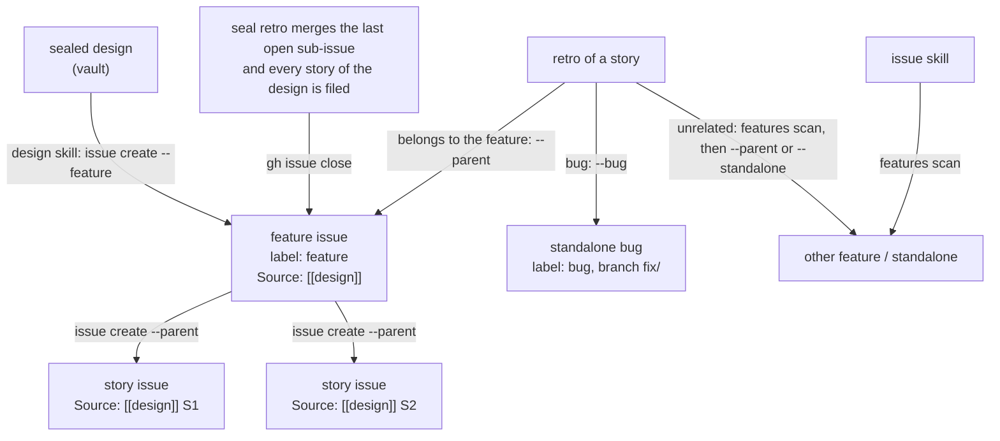

# Features group issues as GitHub sub-issues

## Problem
Every GitHub issue agent-vault files is flat. A design's stories are tied to it only by a `[[<design>]] S<n>` line in each issue's Source section, which `vault.py design stories` reads from the vault side (d54); on GitHub nothing groups them, so the issue list mixes design stories, retro follow-ups, bugs and one-off issues with nothing showing "this belongs to that larger piece of work". A retro follow-up that continues its feature's work (e.g. #54, from the retro of #51) loses that link; an issue filed through the `issue` skill is never checked against work already under way; and a bug looks like any other issue, on GitHub and in its branch name, because `vault.py branch` takes its type from the implementing session's judgment rather than from the issue.

## Goals
- G1. On GitHub, each sealed design's stories are sub-issues of one feature issue that links back to the design.
- G2. Every new issue's place is decided when it is filed: under an open feature, standalone, or a standalone bug. Nothing is filed without that choice, and a design's story can't be filed outside its design's feature.
- G3. Retro follow-ups that clearly belong to the retro'd issue's feature are filed under it; unrelated ones go under another matching feature or stand alone; bugs always stand alone.
- G4. A bug is recognisable at a glance: it carries the `bug` label and its branch is `fix/<n>-<slug>`; no other issue gets a `fix/` branch.
- G5. A feature closes itself once every story of its design is filed and its last open sub-issue is merged through a retro.
- G6. A design whose stories were filed before features existed can get its feature later, with its filed stories attached; agent-vault design-1 (#43–#48) and this design are backfilled that way (see Rollout).

## Non-goals
- Features without a design: grouping loose issues needs a design (interview round 1).
- More than one level: a feature is never a sub-issue, and a story never has sub-issues.
- GitHub issue types, Projects boards and milestones.
- Backfilling movie-nite's two finished designs, or labelling past issues as bugs.
- Guarding raw `gh issue edit --parent`/`--add-sub-issue`: changing an existing issue's parent by hand stays possible.
- The open idea that the design skill should read every repo's open issues (multi-repo).

## Ideas
None

## Options considered

### How related issues are grouped on GitHub
- **A. GitHub sub-issues under a feature issue (chosen).** Each design gets one parent issue; its stories are sub-issues. Pros: native, shown on the issue page with a progress bar, readable through `gh` (2.101 has `issue create --parent`, `issue edit --add-sub-issue`, `--json parent,subIssues,subIssuesSummary`); the feature is itself an issue, so it carries the design's what and links to it. Cons: GitHub never closes a parent by itself; one more issue per design.
- **B. One label per feature** (`feature:<slug>`) on each story. Pros: works with any `gh`; easy to filter. Cons: labels pile up, one per design forever; no place for the feature's own description or a progress view; nothing ties a label to a design.
- **C. A milestone or a GitHub Project per design.** Pros: progress views built in. Cons: milestones are per repo and date-oriented; Projects need their own API scopes (`gh auth refresh -s project`) and live outside the repo; both are a second system beside issues.
- **D. Leave grouping in the vault** (`design stories`). Pros: no change. Cons: nothing visible on GitHub, which is what the user asked for.

### How a feature issue is recognised
- **A. A `feature` label set by agent-vault (chosen).** Like `planned`. Pros: one cheap query (`gh issue list --label feature`); unambiguous even before a story is attached. Cons: a label can be removed by hand.
- **B. GitHub issue type "Feature".** Pros: built for this. Cons: organisation repos only; `d-mayo` is a personal account (issue `type` is null).
- **C. Any issue that has sub-issues.** Pros: no marker at all. Cons: a feature with no story filed yet looks like any issue, so `issue create --parent` couldn't tell a feature from a story.

### How a feature issue is created
- **A. A mode of `issue create`: `--feature <design>` (chosen).** Pros: `issue create` stays the one way issues are created (d22), with the same template check, approval path and guard message; the placement flags become one family. Cons: `issue create` grows a mode with its own checks.
- **B. A separate `vault.py feature create <design>` command.** Pros: its design-specific checks sit apart. Cons: a second command that creates issues, which needs d22 replaced and every "the one way" sentence in the skills, guide and guard rewritten.
- **C. `seal design` creates the feature.** Pros: no extra step; every sealed design is guaranteed one. Cons: `seal design` would post to GitHub a body the user never approved word for word (d21), and it would fail for a project with no repo yet, which today seals fine.
- **D. Created implicitly when the design's first story is filed.** Pros: nothing new for the skill to do. Cons: the feature's body is generated, not approved (d21); a design whose stories are all filed already never gets one, so no backfill.

### How "consider a feature first" is enforced
- **A. `issue create` requires exactly one of `--parent <n>`, `--standalone`, `--bug` or `--feature <design>` (chosen).** Pros: no skill can file an issue without having decided its place (d24); the check that a design story goes under its design's feature lives in code. Cons: one more flag on every call, including quick one-offs.
- **B. Skill instructions only.** Pros: no CLI change. Cons: a skill that skips the step files a flat issue silently, the drift d24 exists to prevent.
- **C. Checked after the fact** (`validate` or SessionStart flags issues with no decision). Pros: no friction at filing. Cons: GitHub issues don't record "standalone on purpose", so there is nothing to check against.

### When a feature closes
- **A. `seal retro` closes it after merging its last open sub-issue, once every story of the design is filed (chosen).** Pros: happens on the path every story already takes; the user's retro approval covers it, as it covers the merge (d66); a story held back for later still has an open feature to go under. Cons: a story closed some other way (by hand, as not planned) leaves the feature open.
- **B. The user closes features by hand.** Pros: nothing to build. Cons: finished features pile up open.
- **C. A GitHub Actions workflow closes a parent when its last sub-issue closes.** Pros: catches every close path. Cons: a workflow in every registered repo for `repo-init` to install and keep current; acts on GitHub with no approval step (d21).

### How bugs are marked
- **A. GitHub's `bug` label, with the branch type derived from it (chosen).** `issue create --bug` sets the label; `vault.py branch` makes `fix/` for a bug and refuses `fix`/`hotfix` for anything else. Pros: decided once, at filing; the issue list, branch and PR all show it; the label already exists in every GitHub repo. Cons: an issue mislabelled at filing needs the label fixed by hand before branching.
- **B. Title prefixes** (`bug:` / `feat:`), which become the squash commit subject on `main`. Pros: visible in history. Cons: free text that nothing checks; GitHub's own filters ignore it.
- **C. A `bug:` / `feature:` branch prefix** (the user's first suggestion). Cons: git refuses `:` in a branch name (`git check-ref-format --branch "feature:43-x"` fails), and branches already carry a type.

## Chosen design

A **feature** is the GitHub side of one sealed design: an issue labelled `feature`, in a repo of the design's project, whose body is the ordinary issue template with `Source` reading `[[<design>]]`. A design's stories are its sub-issues, one level deep. Every other issue is either a sub-issue of an open feature, standalone, or a standalone **bug** (label `bug`). The design note stays the vault-side record and the `[[<design>]] S<n>` Source line stays a story's identity (d54); the sub-issue link mirrors it on GitHub and `design stories` reports any story where the two disagree.

**CLI.**
- `vault.py issue create <repo> --title ... --body-file ... (--feature <design> | --parent <ref> | --standalone | --bug) [--idea <file>]`, and `idea promote` with any of the last three, take exactly one placement flag and refuse without one, so `issue create` stays the one way issues are created (d22). Nothing is posted until every check passes.
  - `--feature <design>`: the design must be sealed and of the project that lists `<repo>`; the body's Source must be `[[<design>]]` with no story number; no issue labelled `feature` with that Source may exist in any state in the project's repos. It ensures the `feature` label, creates the issue with it, then attaches each already-filed story issue of the design (found as `design stories` finds them) that has no parent, with `gh issue edit <feature> --add-sub-issue`; a story already under another parent is reported, never moved. This is also the backfill path for a design whose stories were filed before features existed. `--idea` is refused with it.
  - `--parent <ref>`: `<n>` in the same repo, or `<repo>#<n>` in another repo of the same project; it must be an open issue labelled `feature`, and is passed to `gh issue create --parent` as a URL. GitHub allows sub-issues from other repositories (docs.github.com, "Adding sub-issues"); if GitHub refuses a pairing anyway (e.g. repos under different owners), its error is reported and nothing else is posted. A body whose Source links `[[<design>]] S<n>` must name that design's feature, and is refused when the design has none yet ("file its feature first with `--feature <design>`").
  - `--bug` adds `--label bug` (ensuring the label) and is standalone; `--standalone` adds nothing. A design story's body is refused with either.
- `vault.py features [--project <id>]`: the open features of the project's repos (or all registered repos), one line each: `<repo>#<n> <title> [[<design>]] (<open> of <total> open)`, from `gh issue list --label feature --state open --json number,title,body,subIssuesSummary`.
- `vault.py branch`: a `bug`-labelled issue gets `fix/`, and `--type` other than `fix` is refused for it; `--type fix` or `hotfix` is refused for any other issue, whose default stays `feat`.
- `vault.py seal plan` refuses an issue labelled `feature`, checked before it adds the `planned` label so a refused feature is left unlabelled (`new plan` stays offline), and `vault.py stage` reports a feature as `feature: <open> of <total> sub-issues open` instead of `backlog`. The plan-story skill checks the label while researching and stops there, so no plan is drafted for one.
- `vault.py seal retro`, after its merge (open issue) or seal (closed backfill): when the issue's parent is an open `feature`, every story of that feature's design is filed (as `design stories` counts them), and no sub-issue other than this one is open, it runs `gh issue close <feature> --reason completed` and says so. A failure to close is a warning with the command to run, never a refusal: the PR is already merged.
- `vault.py design stories <design>` also prints the design's feature (`feature: <repo>#<n> (<state>)` or `no feature yet`) and marks a filed story whose parent isn't that feature.
- `vault.py repo-init` ensures the `feature` and `bug` labels alongside `planned`.
- `github.py` gains the calls: create with `--parent`/`--label`, add sub-issue, issue parent and sub-issue states, close. `tests/fake_gh.py` learns them; tests still never touch GitHub.
- Every place that shows `issue create` or `idea promote` usage changes with the flags: `templates/vault-CLAUDE.md` (which also gains `features`), `vault.py`'s argparse help, the push guard's block message, the skills, the repo `CLAUDE.md` and the README.

**Skills.**
- `design`, File the stories: first draft the feature issue (Problem from the design's Problem; Desired outcome from its Goals; Constraints naming its decisions by `D<n>` and title; Out of scope from its Non-goals; Source `[[<design>]]`), get approval of its exact wording, run `issue create <repo> --feature <design>`; then file each story with `--parent <feature>`. Filing later creates the feature first when `design stories` says there is none, even when every story is already filed (G6).
- `issue`: before drafting, run `vault.py features --project <id>` and the open issue list; suggest the feature the issue plainly belongs to, or standalone, and say why; ask whether it is a bug. The approval shown to the user names the placement ("under feature #N", "standalone", "standalone bug"), and the user's approval covers it.
- `retro`, Follow-ups: for each follow-up issue, decide its place: under the retro'd issue's feature only when it clearly continues that feature's work; `--bug` for a bug, always; otherwise scan `features` for a match or file it standalone. Work for another project's repo is filed there, never under this feature. The summary names a feature that sealing will close; approving the summary approves that close.
- `plan-story` stops when the issue is labelled `feature` (and lists that under Stop and ask); `implement-story` changes only its wording about choosing `--type`.

**Rollout.** This design's own stories are filed flat when it is sealed, since S1 doesn't exist yet. Once S1 is merged and `install.py` has been rerun, the user asks a session to "file the stories of" agent-vault design-1 and then this design; each run drafts the design's feature, gets its wording approved, and creates it with its filed stories attached. S1's retro lists this as its first follow-up, so it isn't forgotten.

Technology: Python 3.9+ standard library; GitHub CLI with sub-issue support (2.101 installed here; S1 finds the oldest version that has it, names it in the README, and turns gh's unknown-flag error into "update gh to <version> or later"); GitHub sub-issues; the GitHub-default `bug` label and an agent-vault `feature` label.

## Decisions

### D1. A feature is the GitHub issue of one sealed design
Decision: A sealed design has at most one feature issue, in a repo of its project, labelled `feature`, in the ordinary issue template with Source `[[<design>]]`, created through `vault.py issue create --feature <design>` before its stories are filed or later, attaching the stories already filed; there are no features without a design.
Why: The design already is the larger unit with its reasoning in the vault, so the feature only has to show it on GitHub; one per design keeps the grouping traceable both ways, and creating it through `issue create` keeps d22's single path for new issues.

### D2. Features are one level deep and a story is always a sub-issue of its design's feature
Decision: Only an open issue labelled `feature` can be a parent, a feature is never a sub-issue, and `issue create` refuses a body naming `[[<design>]] S<n>` unless its parent is that design's feature; the Source line stays the story's identity and the sub-issue link mirrors it.
Why: One level keeps the tree readable and the checks simple, and enforcing the story's parent in code keeps GitHub's grouping from drifting away from the design.

### D3. Every new issue declares its place when it is filed
Decision: `issue create` takes exactly one of `--feature <design>`, `--parent <feature>`, `--standalone` or `--bug`, `idea promote` one of the last three, and both refuse with none.
Why: Choosing a feature is judgment, but having considered one must always happen, so code enforces the choice and the skills supply the judgment (d24).

### D4. A bug is always standalone, labelled bug, and branched fix/
Decision: `issue create --bug` files a standalone issue with the `bug` label; `vault.py branch` gives a bug `fix/` and refuses `fix`/`hotfix` for any other issue.
Why: The user wants bugs and feature work told apart at a glance, decided once at filing; git refuses `:` in branch names, so the existing branch type carries the marker.

### D5. seal retro closes a feature once its design is fully filed and its last open sub-issue is merged
Decision: After merging, or sealing a closed issue's retro, `seal retro` closes the issue's parent feature when every story of its design is filed and no other sub-issue is still open, and the retro summary the user approves names that close.
Why: GitHub never closes a parent itself, and the retro is the step every story already passes through with the user's approval, so the feature closes without the user having to remember it, while a story held back for later still has an open feature to be filed under.

### D6. A feature is never planned or implemented
Decision: `vault.py seal plan` refuses an issue labelled `feature`, `stage` reports a feature by its sub-issues instead of as backlog, and only its sub-issues go through the plan, implement and retro pipeline.
Why: A feature's work is its stories; a plan for the feature would duplicate the design and leave nothing for its stories' plans to own.

## Stories

### S1. Design features on GitHub
Outcome: `vault.py issue create <repo> --feature <design>` files a sealed design's feature with the `feature` label and attaches its already-filed stories as sub-issues; `issue create` and `idea promote` accept `--parent <n>` or `<repo>#<n>` and refuse a parent that isn't an open feature of the same project; `vault.py features` lists open features with their open sub-issue counts; `design stories` shows the feature and any story not under it; `seal plan` refuses a feature and `stage` reports it by its sub-issues; `repo-init` ensures the `feature` and `bug` labels; the vault guide template, README and repo `CLAUDE.md` show the new flags and `features`; the README names the oldest `gh` with sub-issue support and an older `gh` gets "update gh"; the design skill files the feature before its stories and files stories with `--parent`, its Filing later step creates a missing feature for a design whose stories are already filed, and plan-story stops on a feature.
Depends on: None

### S2. Every new issue declares its place
Outcome: `issue create` refuses without exactly one of `--feature`, `--parent`, `--standalone` or `--bug`, and `idea promote` without one of the last three; `--bug` adds the `bug` label; a design story's body is refused unless its parent is that design's feature; the issue skill scans open features and suggests one or standalone, asks whether it is a bug and shows the placement in what the user approves; the retro skill sorts each follow-up issue into the feature, a bug, another feature or standalone; the vault guide template, the push guard's message, the skills, the README and the repo `CLAUDE.md` all show a placement flag in every `issue create` and `idea promote` they mention.
Depends on: S1

### S3. Bugs branch as fix/
Outcome: `vault.py branch` gives a `bug`-labelled issue a `fix/` branch and refuses another type for it, refuses `fix` and `hotfix` for an issue without the label, and still defaults other issues to `feat/`; implement-story's wording about choosing `--type` matches.
Depends on: S2

### S4. seal retro closes a finished feature
Outcome: When `seal retro` merges (or seals the closed issue of) a feature's last open sub-issue and every story of the feature's design is filed, the feature is closed as completed and the output says so; with a story still unfiled the feature stays open; a failure to close is a warning naming the command, never a refusal; the retro skill's summary names the feature that sealing will close.
Depends on: S1

## Open questions
- Whether a cross-repo `--parent` works for this user's repos in practice: GitHub's docs allow it, but no project has two repos yet, and the tests use `tests/fake_gh.py`. Settled by the first cross-repo story once a project registers a second repo; until then GitHub's refusal, if any, is reported.
- A story closed without a retro (by hand, or as not planned) never triggers D5, so its feature can stay open with nothing left. Settled by whether it happens; `design stories` already shows it, and the user closes the feature by hand.
- A story the user decides never to file keeps its feature open for good, since D5 waits for every story to be filed and nothing can mark a story dropped. Settled by whether it happens: the user closes the feature by hand, or a later design that replaces this one drops the story.
- A follow-up that belongs to a feature already closed (e.g. found in a backfill retro after the last story merged) can't go under it, since `--parent` needs an open feature. Settled by whether that happens; until then it is filed standalone or the feature is reopened by hand.
- Whether the installer's prerequisite check (#47, design-1 S5, not yet planned) should require the `gh` version S1 finds. Settled by S1: if that version is newer than what users plausibly have, S1's retro amends #47 (d23).