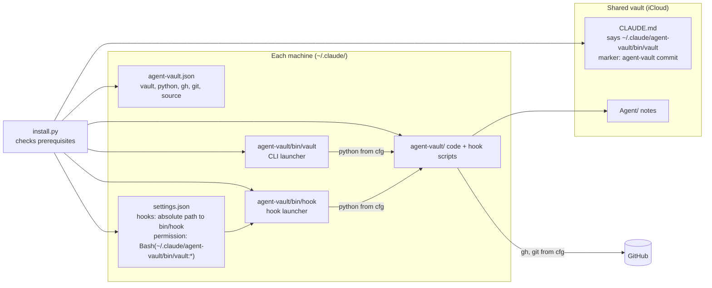

# Portable across machines and setups

## Problem
agent-vault has only ever run on one Windows PC. The user wants to install it on several Windows and macOS machines that share one iCloud-synced vault, and have it just work. Today it can't:

- `install.py` writes this machine's CLI string (absolute Python path plus absolute `vault.py` path) into `<vault>/CLAUDE.md`. The vault syncs, so a second machine's install overwrites the first's, and every session on the other machine reads a path that doesn't exist there. Two machines on different agent-vault versions would also keep rewriting the shared guide.
- The skills say the CLI is "the line under 'CLI after install'" in the vault's `CLAUDE.md`, but the vault template has no such heading; it works only because the string appears inline in the commands.
- `github.py` finds `gh` on PATH or, on Windows only, in its standard install folders. A Claude app launched from the macOS Finder often lacks `/opt/homebrew/bin` on PATH, where `gh` and `git` usually live.
- The installer records its Python (d38), but the Claude hook commands bake that path in. Homebrew moves it on every Python upgrade, as the Microsoft Store does on Windows; every hook then fails to start, which Claude Code treats as a non-blocking error, so the guards silently stop protecting anything.
- `core.hooksPath` is set per clone by `repo-init`, so a new machine's existing clones have no pre-push guard until it is rerun in each.
- Nothing has ever run on macOS: there is no CI, and the tests run only on the user's PC.
- Wording ties the code to this user's setup: `d-mayo/agent-vault` is hardcoded in `guard.py`'s messages and the vault template, and the README's only install example is an iCloud path on Windows.

This is the first of three portability steps the user has in mind: (1) their own Windows and macOS machines, (2) their work setup (no iCloud, Jira instead of GitHub issues, a team that touches the code and reviews PRs, the user's own PR reviews touching the vault), (3) an open plugin anyone can point at their own vault and repos. This design delivers (1) and keeps (2) and (3) open.

## Goals
- G1. A second machine, Windows or macOS, gets a working setup from a clone, `install.py` and `repo-init` in its existing clones, without changing anything another machine relies on.
- G2. Nothing in the shared vault is specific to one machine.
- G3. macOS support is proven, not assumed: the test suite runs on Windows and macOS for every PR, and a real session has run on the user's Mac.
- G4. When a machine's setup breaks (missing tool, moved Python), the CLI, every hook and the pre-push hook say what is missing and how to fix it, and the guards fail closed instead of silently.
- G5. Nothing here makes the later work-setup design or a plugin pivot harder.

## Non-goals
- The work setup: Jira, a team workflow, reviewing other people's PRs, a vault not on iCloud, SSH instead of `gh` credentials. That is a later design.
- Packaging as a Claude Code plugin; this design only keeps that route open.
- Several writers on one vault at the same moment (two machines, or several agents on one machine); see Open questions.
- Linux. It may well work, but it isn't tested or promised.
- Installing prerequisites for the user; the installer checks them and says what to do.
- A Claude config folder other than `~/.claude` (`CLAUDE_CONFIG_DIR`).
- Open issues #25 (the skills' "never run `install.py`" wording) and #42 (the retro auditing the vault guide and code wording) stay separate: neither blocks nor is absorbed by this design, though S6 rewrites wording #42 would audit.

## Ideas
- [[2026-10-01-make-agent-vault-portable-across-machines-and-setups]]

## Options considered

### How each machine runs the CLI
- **A. A launcher at the same home-relative path on every machine (chosen).** The installer writes `~/.claude/agent-vault/bin/vault`, a POSIX `sh` script that runs that machine's recorded Python on the installed `vault.py`. The vault's `CLAUDE.md`, the skills and the permission rule all say `~/.claude/agent-vault/bin/vault`: the same text everywhere, which the shell expands at run time. Pros: the vault holds no machine-specific text; one string to match in the permission rule; a later plugin's `bin/` is the same mechanism, so the pivot is a mechanical rename to `vault`. Cons: one more installed file; runs in Bash (Git Bash on Windows) but not in PowerShell or cmd.
- **B. Keep the absolute string, delivered per machine.** The vault's `CLAUDE.md` says "use the CLI shown in your session-start context", and SessionStart gains a line printing `lib.CLI` (today it shows it only inside lint and validate warnings). Pros: no new file; the permission rule is unchanged. Cons: the vault and skills can no longer show a runnable command; every skill depends on hook output, and a session whose start context was compacted away has no CLI; a subagent never sees it.
- **C. Package as a plugin now.** A plugin's `bin/` is on the Bash tool's PATH, so the command would be `vault`. Pros: the end state for step 3, and the expected way others install Claude Code add-ons. Cons: a plugin can't add the permission rule or record a fixed Python, its folder moves on every update (no stable `core.hooksPath` target), and it is far more work than step 1 needs.

### How the Claude hooks survive a moved Python
- **A. Hooks run through a hook launcher (chosen).** `~/.claude/agent-vault/bin/hook <script>` reads the Python from `agent-vault.json` at run time and runs the hook script; settings hold the launcher's absolute path. If the config exists but its Python is gone, it refuses: exit 2 with "rerun install.py" for the PreToolUse guards (the tool call is blocked, so they fail closed), and exit 1 with the same message for SessionStart, PostToolUse and Stop (a non-blocking error the user sees; SessionStart also prints it on stdout, which goes into Claude's context), so a session is never blocked from starting or stopping. With no config at all it exits 0 silently, as the hooks do today. Pros: the guards never silently switch off; d38's "the hooks read Python from the config" becomes literally true. Cons: one more process per hook call; relies on the Windows hook runner running an `sh` script; while Python is missing, every Write, Edit, Bash and PowerShell call in every Claude session on the machine is blocked (the hooks are user-level, d9), including other projects, so the user must rerun `install.py` from their own terminal before Claude can do anything.
- **B. Keep the absolute Python in each hook command.** Pros: no change. Cons: a moved Python silently disables every guard until someone notices.
- **C. Hook commands use a bare `python3`/`python` from PATH.** Pros: survives upgrades. Cons: on Windows `python` may be the Store stub or another install, and a Finder-launched macOS app may not see Homebrew's; d38 exists to avoid exactly this.

### How macOS support is verified
- **A. CI plus one manual Mac run (chosen).** A GitHub Actions workflow runs the lint and tests on `windows-latest` and `macos-latest` for every PR and push to `main`; S6 ends with the user installing on their Mac and running real sessions. Pros: catches regressions on every PR; free for a public repo; the manual run covers what CI can't (Claude Code hooks firing, Finder PATH, the iCloud path with spaces). Cons: the repo's first CI, one more moving part.
- **B. Manual Mac checks only.** Pros: nothing new to maintain. Cons: a macOS break is found only when the user happens to use the Mac.
- **C. CI only.** Pros: automatic. Cons: never exercises Claude Code itself, so hook and PATH problems ship unseen.

### How the code finds `gh` and `git`
- **A. Record their paths at install time (chosen).** The installer resolves `gh` and `git` from PATH (in the terminal where it runs) and writes them to `~/.claude/agent-vault.json`, the way d38 records Python. At run time: `AGENT_VAULT_GH` (for `gh`), then the recorded path, then PATH. Pros: works however Claude was launched; one rule for every platform, so the Windows-only fallback goes. Cons: moving a tool means rerunning the installer, which the message will say.
- **B. Require a correct PATH.** Refuse clearly when a tool is missing. Pros: simplest. Cons: a Finder-launched app on macOS fails out of the box, and the user has to fix an environment they don't control easily.
- **C. Per-platform search lists** (the current Windows fallback, plus Homebrew folders on macOS). Pros: no install-time step. Cons: grows a list per platform and per package manager, the opposite of portable.

### What happens when two machines run different agent-vault versions
- **A. The installer won't downgrade the shared guide, judged by commit time (chosen).** The vault guide carries a marker line with the committer time and id of the agent-vault commit it was written from; the installer rewrites it only when its own `HEAD`'s committer time is the same or later, and otherwise warns "the vault guide is from a newer agent-vault; git pull and rerun". Pros: an older machine still installs its local parts without undoing the newer guide; works with squash merges (a feature-branch commit is older than the squash commit that later lands on `main`) and with forks, since no shared history is needed. Cons: relies on sane clocks; an install from a feature branch whose commit is newer than `main`'s head holds the guide until `main` moves on, or `--force-guide`.
- **B. Judge by git ancestry** (`git merge-base --is-ancestor`). Pros: exact. Cons: squash-only merges mean a feature-branch commit is never an ancestor of `main`, so one install from a branch makes every later install from `main` look older forever.
- **C. Last install wins.** Pros: no new logic. Cons: a stale machine silently rewrites the shared guide, which G1 rules out.

## Chosen design

Everything machine-specific lives on the machine, in `~/.claude/`; everything in the vault is the same text on every machine.

**Launchers.** `install.py` writes two POSIX `sh` scripts into `~/.claude/agent-vault/bin/`, LF endings, executable bit set. Both read the `python` field from `${AGENT_VAULT_CONFIG:-$HOME/.claude/agent-vault.json}` with the same `sed` the pre-push hook already uses, so tests drive them with a temp config exactly as they drive the pre-push hook today.
- `vault` runs that Python on `vault.py` next to its folder, passing every argument through; with the Python missing it exits non-zero with "agent-vault's Python (<path>) is gone; rerun install.py".
- `hook <script> [--blocking]` runs that Python on `hooks/<script>`, passing stdin through. With no config file it exits 0 silently (the repo convention for an uninstalled machine). With a config whose Python is missing it prints "rerun install.py" on stderr and exits 2 when `--blocking` (the two PreToolUse guards), 1 otherwise (a non-blocking error the user sees); for SessionStart it also prints the message on stdout so it reaches Claude's context.

`lib.CLI` becomes `~/.claude/agent-vault/bin/vault`, so the vault template, SessionStart output, hook messages, the permission rule (`Bash(~/.claude/agent-vault/bin/vault:*)`) and the skills all use that one string. The skills drop the `vault.py <command>` shorthand and their "always ends in `vault.py`" note and write the literal command, since it is now the same everywhere; `tests/test_skills.py`'s command parser changes to match. `claudemd.py`'s command check expands a leading `~/` instead of treating it as repo-relative, so the repo `CLAUDE.md` can name the launcher and still pass the lint. Hook commands in settings are the hook launcher's absolute forward-slash path plus the script name: absolute because of the repo `CLAUDE.md` gotcha about the Windows hook runner's `$HOME` expansion, and fine because user settings are per machine. The installer still removes the old absolute rule and hook commands through `managed_allow` and the `/.claude/agent-vault/` mark. On Windows the Bash tool and the hook runner use Git Bash, which runs `sh` scripts. Both mechanisms were checked on the user's Windows PC on 2026-10-04 in a throwaway project (Claude Code 2.1.286): a `Bash(~/…/bin/hello:*)` rule let `~/…/bin/hello` run without a prompt while an unlisted sibling script prompted, and a hook whose command was a bare `sh` script's absolute path fired on every Bash call. macOS runs `sh` natively; S6's Mac run confirms both there. The repo `CLAUDE.md`'s Commands and Gotchas lines about `lib.CLI` and the hook commands, and its Conventions line "Claude hooks exit 0 silently" (which now holds only with no config), are rewritten to match.

**Version guard on the shared guide.** The vault guide gets a first-line marker `<!-- agent-vault <committer-time> <commit> -->` from its clone's `HEAD` (`git log -1 --format=%ct %H`). The installer writes the guide only when the marker is missing or its time is the same as or earlier than its own `HEAD`'s, and otherwise warns and leaves it alone (everything machine-local still installs). `--force-guide` overrides.

**Tools.** The installer records `gh` and `git` (resolved with `shutil.which` where it runs) in `agent-vault.json`. `github.py` finds `gh` through `AGENT_VAULT_GH`, then the recorded path, then PATH; `git` through the recorded path, then PATH. The Windows-only `gh` search is removed. `ruff` stays required on PATH (d37); it is only this repo's development lint.

**Prerequisite check.** Before writing anything, `install.py` checks Python ≥ 3.9, `git`, and `gh` installed and logged in (`gh auth status`). A missing one stops the install and names the fix; a missing `ruff` is a warning. How git authenticates (d15's `gh` credential helper, SSH, anything else) is not checked: that is a personal choice and the work setup may differ.

**Second machine.** After installing, the installer lists the registered repos and says to run `repo-init` in each existing clone on this machine, since `core.hooksPath` is per clone; `repo-init` is already idempotent.

**Setup-neutral wording.** The installer records the clone it ran from as `source` in `agent-vault.json`; `guard.py` names that folder instead of `d-mayo/agent-vault` in its "change it in the repo" messages, and the vault template says "the agent-vault repo" without an owner. The README gives Windows and macOS install steps with a placeholder vault path, not an iCloud example, and the second-machine `repo-init` step. The repo `CLAUDE.md` says the code must run on Windows and macOS.

**CI.** `.github/workflows/test.yml` on `pull_request` and push to `main`: matrix `os: [windows-latest, macos-latest]` × `python: ["3.9", "3.12"]`, with `actions/checkout@v4`, `actions/setup-python@v5`, `pip install ruff`, `ruff check .`, then `python -m unittest discover -s tests -t .`. Tests already never touch GitHub (`tests/fake_gh.py`). CI is not a required check; the local pre-push hook stays the gate.

Technology: Python 3.9+ standard library; POSIX `sh` for the launchers (Git Bash on Windows, `/bin/sh` on macOS); GitHub Actions hosted runners; `ruff` from pip.

## Decisions

### D1. Nothing specific to one machine is written into the vault
Decision: The installer and the CLI write no machine-specific text (absolute paths, interpreters, user names) into the vault; everything machine-specific lives in `~/.claude/` on that machine.
Why: The vault syncs between machines, so any machine-specific text written there is overwritten by the next machine's install and then wrong on the other.

### D2. The CLI is run everywhere as ~/.claude/agent-vault/bin/vault
Decision: The installer writes a POSIX sh launcher at `~/.claude/agent-vault/bin/vault` that runs the Python recorded in `agent-vault.json` on the installed `vault.py`; `lib.CLI`, the vault guide, the skills and the CLI permission rule all use that exact string.
Why: The same text is right on every machine, so the shared vault and skills can show a runnable command that one permission rule matches, and a later plugin's `bin/` uses the same mechanism.

### D3. Claude hooks run through a launcher that fails closed when Python is gone
Decision: Hook commands in user settings call `~/.claude/agent-vault/bin/hook` by absolute path; it reads the Python from `agent-vault.json`, and when the config exists but that Python is missing it blocks the PreToolUse guards with "rerun install.py" and reports the same as a visible non-blocking error in SessionStart, PostToolUse and Stop; with no config it stays silent.
Why: Homebrew and the Microsoft Store move Python on upgrade, and a hook that fails to start is a non-blocking error, so without this the guards silently switch off; blocking tool calls until the user reruns the installer is preferred to unguarded sessions, while never blocking a session from starting or stopping.

### D4. agent-vault supports Windows and macOS, and CI runs the suite on both
Decision: The supported platforms are Windows and macOS; a GitHub Actions workflow runs the lint and the tests on both, with Python 3.9 and 3.12, for every PR and push to `main`, without being a required check.
Why: It catches a platform regression on every PR at no cost for a public repo, while the local pre-push hook stays the gate.

### D5. gh and git are found through paths the installer records
Decision: The installer records the paths of `gh` and `git` in `agent-vault.json`; the code uses `AGENT_VAULT_GH` (for `gh`), then the recorded path, then PATH, and has no per-platform search lists.
Why: A Claude app launched from the macOS Finder often lacks Homebrew's PATH, and recording at install time follows the rule d38 set for Python with one code path for every platform.

### D6. The installer checks its prerequisites before changing anything
Decision: `install.py` checks Python 3.9+, `git`, and `gh` installed and logged in before it writes anything, stops on a missing one naming the fix, only warns about a missing `ruff`, and does not check how git authenticates.
Why: A second machine should either install completely or say exactly what is missing, and leaving git authentication unchecked keeps d15's personal choice from locking out a different setup.

### D7. The installer never downgrades the shared vault guide
Decision: The vault guide carries the committer time and id of the agent-vault commit it was written from, and the installer rewrites it only when its own `HEAD` is the same age or newer, unless forced.
Why: Machines install from their own clones and may lag, and a stale machine must not undo the guide a newer machine wrote to the shared vault; commit time, unlike ancestry, still works with squash-only merges.

### D8. Portability work adds no absolute paths to shared or packaged files
Decision: Code, skills and templates derive every path from the install folder, the config or `~`, never from an absolute path baked in at install, outside per-machine user settings and `agent-vault.json`.
Why: It keeps a later move to a Claude Code plugin, whose folder changes on every update, a packaging change instead of a rewrite.

## Stories

### S1. The test suite runs on Windows and macOS in CI
Outcome: Every PR and push to `main` runs `ruff check .` and the unit tests on `windows-latest` and `macos-latest` with Python 3.9 and 3.12, all green; any code or test that failed on macOS is fixed, including a mixed-case path test of the guard on macOS; the repo `CLAUDE.md` says the code must run on Windows and macOS.
Depends on: None

### S2. One CLI command that is the same on every machine
Outcome: `install.py` writes the `vault` launcher; the vault guide, SessionStart output, hook messages, skills and the CLI permission rule all use `~/.claude/agent-vault/bin/vault`, the skills write it literally, and `claudemd-lint` accepts it in the repo `CLAUDE.md`; with the recorded Python missing the CLI refuses with "rerun install.py"; installing from the same commit with a different Python leaves `<vault>/CLAUDE.md` byte-for-byte unchanged; the repo `CLAUDE.md`'s Commands and Gotchas lines match.
Depends on: S1

### S3. Claude hooks fail closed when Python is gone
Outcome: The hook commands in user settings call the `hook` launcher; with a config whose Python is missing, the PreToolUse guards block with "rerun install.py" and SessionStart, PostToolUse and Stop report it as a visible non-blocking error (SessionStart also in Claude's context); with no config every hook stays silent; the repo `CLAUDE.md`'s hook gotcha and "exit 0 silently" convention match.
Depends on: S2

### S4. The installer never downgrades the shared vault guide
Outcome: The vault guide's first line records the committer time and id of the commit it was written from; an install from a clone whose `HEAD` is older leaves the guide unchanged and warns to pull, while everything machine-local still installs; `--force-guide` overrides.
Depends on: S1

### S5. The installer checks prerequisites and records gh and git
Outcome: `install.py` refuses, changing nothing, when Python is older than 3.9 or `git` or `gh` is missing or `gh` is not logged in, naming the fix for each, and warns about a missing `ruff`; it records `gh` and `git` in `agent-vault.json`, and the code finds them there, with no Windows-only search left.
Depends on: S1

### S6. Setup-neutral wording and a verified Mac install
Outcome: No code or template names `d-mayo/agent-vault` (the guard names the recorded `source` clone instead); the installer ends by naming the registered repos to `repo-init` on this machine; the README gives Windows and macOS install steps with a placeholder vault path and the `repo-init` step; following those steps on the user's Mac gives a vault session and a clone session where the Claude hooks fire, the CLI runs without a permission prompt, and a push runs the pre-push lint.
Depends on: S2, S3, S4, S5

## Open questions
- The launchers run in Bash, not PowerShell or cmd, including the installer's own closing `check:` command and the README's commands. If the CLI is needed from those shells, it needs a `.cmd` twin. Settled by whether a skill or the user needs it there; S2 can print the check in a form for both.
- Several agents on one machine writing at once could take the same decision or design number or interleave a daily note. Settled by a later design, once parallel agents are actually used.
- `actions/setup-python` may not offer Python 3.9 on the arm64 `macos-latest` runner. Settled by S1's first run; if it doesn't, the 3.9 job runs on Windows only or on an Intel macOS runner.
- macOS file systems are case-insensitive, but `os.path.normcase` doesn't fold case there, so the guard's "is this path inside the vault" test might miss a path written in different case. Settled by S1's macOS test; the fix, if needed, is part of S1.
- Whether a Finder-launched Claude app on macOS finds `ruff` for the pre-push lint when Claude pushes. Settled by the S6 Mac run.